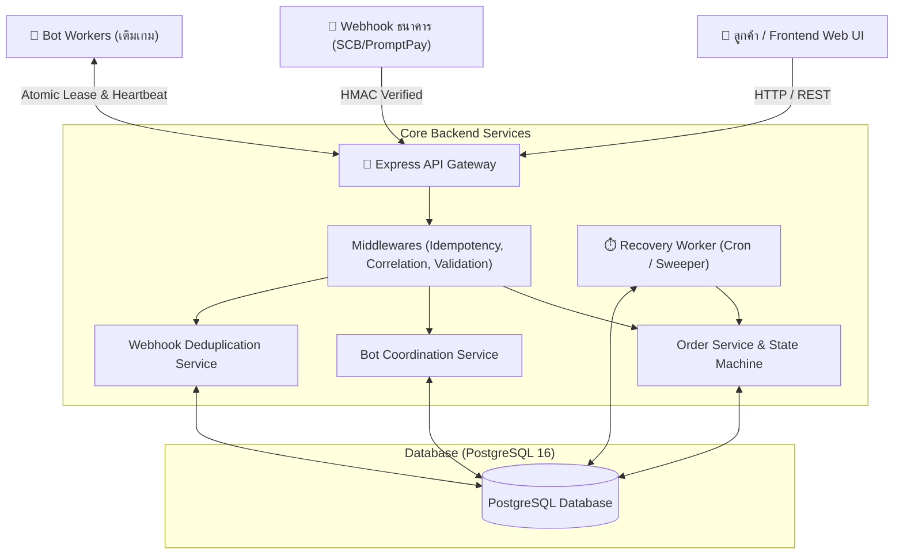
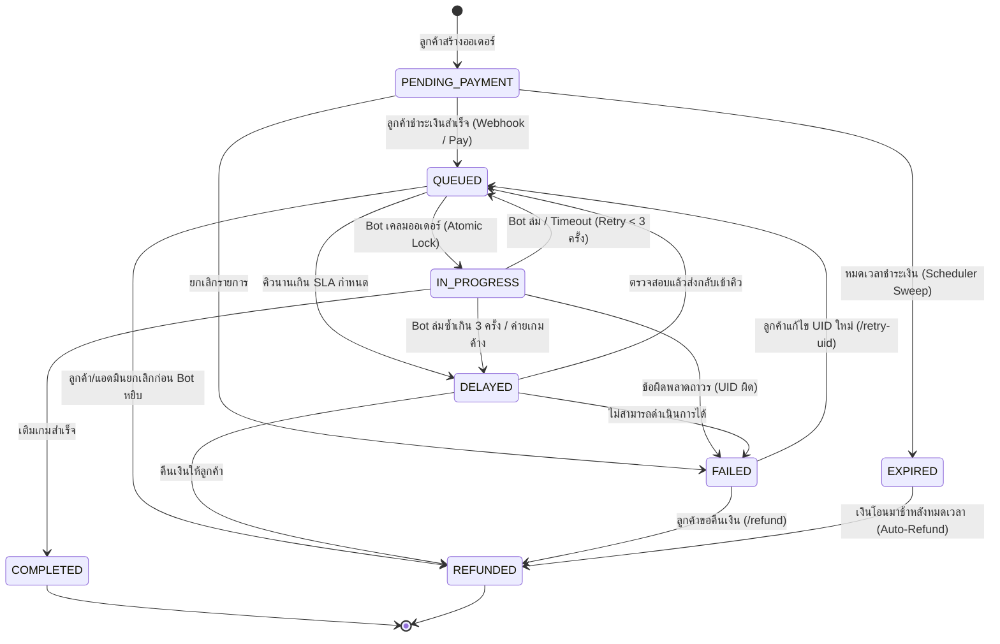

# 🎮 InblackM - Order Tracking & Problem Resolution API

ระบบติดตามออเดอร์สำหรับร้านเติมเกม (Order Tracking API) พร้อมกลไกตรวจจับและกู้คืนเคสปัญหาอัตโนมัติ (Self-Healing System) สำหรับตำแหน่ง **Back-End Developer**

[](https://nodejs.org/)
[](https://www.typescriptlang.org/)
[](https://www.postgresql.org/)
[](https://www.docker.com/)
[]()
[]()

---

## 📑 สารบัญ (Table of Contents)
1. [ภาพรวมสถาปัตยกรรมระบบ (System Architecture)](#1-ภาพรวมสถาปัตยกรรมระบบ-system-architecture)
2. [State Machine และการออกแบบ Schema](#2-state-machine-และการออกแบบ-schema)
3. [การวิเคราะห์และการแก้ปัญหา 5 เคส (Deep Dive 5 Problem Cases)](#3-การวิเคราะห์และการแก้ปัญหา-5-เคส-deep-dive-5-problem-cases)
4. [รายการ API และการเรียกใช้งาน (API Reference)](#4-รายการ-api-และการเรียกใช้งาน-api-reference)
5. [การรันระบบด้วย Docker Compose (คำสั่งเดียว)](#5-การรันระบบด้วย-docker-compose-คำสั่งเดียว)
6. [การทดสอบ Unit & Integration Tests](#6-การทดสอบ-unit--integration-tests)
7. [Interactive Live Demo Dashboard](#7-interactive-live-demo-dashboard)
8. [Postman Collection & .http Client](#8-postman-collection--http-client)
9. [การประเมินและการใช้ AI อย่างมีวิจารณญาณ](#9-การประเมินและการใช้-ai-อย่างมีวิจารณญาณ)

---

## 1. ภาพรวมสถาปัตยกรรมระบบ (System Architecture)

ระบบถูกออกแบบด้วยหลักการ **Layered Architecture & Domain Separation** เพื่อให้ง่ายต่อการขยายตัว (Scalability), รองรับ Concurrency สูง และสามารถตรวจจับกู้คืนความผิดพลาดได้อัตโนมัติ:



### Tech Stack ที่เลือกใช้และเหตุผล:
- **Node.js (v22 LTS) & TypeScript**: Type-safe, ประสิทธิภาพ I/O สูงสำหรับการประมวลผล asynchronous requests และ Webhook events
- **Express.js**: ควบคุม Request Lifecycle ได้ยืดหยุ่น สร้าง Idempotency Middleware และ Custom Error Pipeline ได้อย่างแม่นยำ
- **PostgreSQL 16**: รองรับ Row-level locking ขั้นสูง (`FOR UPDATE SKIP LOCKED`), JSONB สำหรับ Audit Metadata, และ ACID Transactions
- **Docker Compose**: รันคำสั่งเดียว (`docker compose up --build`) ได้ทั้ง Database, Migration, Seed Data และ Background Workers ทันที
- **Winston Logger**: Structured JSON Logging พร้อม Correlation ID และ `orderNo` tracing ทุกจุด
- **Zod**: Runtime request schema validation ป้องกันข้อมูลผิดพลาดตั้งแต่ทางเข้า
- **Jest & Supertest**: ทดสอบทั้ง Unit Test (State Machine, Hashing) และ Integration Test (Concurrency, Recovery, Webhook)

---

## 2. State Machine และการออกแบบ Schema

### 2.1 Finite State Machine (FSM)

ระบบควบคุมวงจรชีวิตของออเดอร์อย่างเข้มงวดด้วย Transition Matrix ป้องกันการข้ามสถานะที่ผิดปกติ:



### 2.2 ตารางฐานข้อมูล (Database Schema)

1. **`orders`**: เก็บข้อมูลออเดอร์, สถานะ, ข้อมูลการถือครองของ Bot (`locked_by`, `locked_until`, `last_heartbeat_at`), จำนวนครั้ง retry (`retry_count`), และเวลาหมดอายุ (`expires_at`)
2. **`order_timeline`**: บันทึก Audit Log ทุกการเปลี่ยนสถานะ พร้อม `actor` (CUSTOMER, BOT, BANK_WEBHOOK, SYSTEM, ADMIN), `action`, เหตุผล และ metadata ในรูปแบบ JSONB
3. **`order_issues`**: บันทึกคำร้องแจ้งปัญหาจากลูกค้า
4. **`idempotency_records`**: บันทึก Request Hash และ Response Caching สำหรับคำขอที่มี `Idempotency-Key`
5. **`webhook_events`**: บันทึก Event ID จากธนาคารเพื่อป้องกัน Webhook ยิงซ้ำ
6. **`system_alerts`**: บันทึกแจ้งเตือนอัตโนมัติเมื่อเกิด SLA Breach หรือ Bot ล่มเกินโควตา

---

## 3. การวิเคราะห์และการแก้ปัญหา 5 เคส (Deep Dive 5 Problem Cases)

### 📌 เคสที่ 1: Bot จ่ายเงินไม่ทำงาน (Bot ล่ม, Cookie หมดอายุ, Timeout ทำให้ออเดอร์ค้าง)

#### 🔴 ปัญหา:
เมื่อ Bot ดึงออเดอร์ไปทำรายการ (สถานะ `IN_PROGRESS`) แล้วเกิดข้อผิดพลาด เช่น ตัวโปรแกรมแครช, เน็ตเวิร์กหลุด, หรือ Cookie เว็บเติมเกมหมดอายุ ออเดอร์จะค้างอยู่ที่ `IN_PROGRESS` ทำให้ลูกค้าไม่ได้รับของและไม่มี Bot ตัวอื่นหยิบไปทำต่อ

#### 🟢 Solution ที่เลือก: **Distributed Lease Lock + Heartbeat Pattern + Exponential Backoff Recovery**
1. **Heartbeat Lease**: เมื่อ Bot หยิบออเดอร์ จะได้รับสัญญาเช่า (Lease) มีอายุ 30 วินาที (`locked_until = NOW() + INTERVAL '30 seconds'`)
2. **Heartbeat Keep-Alive**: ระหว่างที่ Bot ทำงาน จะต้องส่งสัญญาณชีพมาที่ `POST /bot/orders/:orderNo/heartbeat` ทุก ๆ 10 วินาที เพื่อต่ออายุ Lease
3. **Self-Healing Recovery Worker**: เบื้องหลังมี Scheduler ตรวจสอบทุก 5 วินาที หากพบออเดอร์ในสถานะ `IN_PROGRESS` ที่ `locked_until < NOW()` (Bot เงียบไปเกินเวลา):
   - **กรณี `retry_count < 3`**: ปลดล็อค `locked_by = NULL`, เพิ่ม `retry_count + 1`, และคืนสถานะกลับเป็น `QUEUED` พร้อมบันทึกลง Timeline ว่า `BOT_HEARTBEAT_LEASE_EXPIRED_RETRY`
   - **กรณี `retry_count >= 3`**: ถือว่าเกิดปัญหาเรื้อรัง ระบบจะย้ายสถานะเป็น `DELAYED`, ปลดล็อค, และสร้าง Alert ใน `system_alerts` (`BOT_CRASH_MAX_RETRY`) เพื่อแจ้งเตือนแอดมินเข้ามาตรวจสอบทันที

---

### 📌 เคสที่ 2: Bot สองตัวแย่งออเดอร์เดียวกัน (Race Condition ทำให้จ่ายซ้ำ)

#### 🔴 ปัญหา:
ในระบบที่มี Worker Bot หลายตัว (เช่น Bot-1 ถึง Bot-10) ทุกตัวอาจ Polling คิวพร้อมกันในมิลลิวินาทีเดียวกัน หากใช้คำสั่ง `SELECT` ธรรมดา Bot ทั้งสองตัวจะเห็นออเดอร์เดียวกันและทำการตัดเงินซ้ำซ้อน

#### 🟢 Solution ที่เลือก: **Pessimistic Concurrency Control ด้วย `SELECT ... FOR UPDATE SKIP LOCKED`**
1. ในจังหวะที่ Bot เรียก `POST /bot/claim` ระบบจะทำคำสั่งภายใน Transaction:
   ```sql
   SELECT * FROM orders 
   WHERE status = 'QUEUED' 
     AND (locked_until IS NULL OR locked_until < NOW())
   ORDER BY created_at ASC 
   LIMIT 1 
   FOR UPDATE SKIP LOCKED;
   ```
2. **ทำไมถึงเลือก `SKIP LOCKED`**:
   - `FOR UPDATE` จะ Lock แถวในระดับ Row-level
   - `SKIP LOCKED` ทำให้ Transaction อื่นที่ไม่ใช่เจ้าของ Lock ไม่ต้องรอนานจน Timeout แต่จะข้ามแถวนั้นไปหยิบแถวถัดไปทันที
   - การันตีได้ 100% ว่าจะ **ไม่มี Bot สองตัวหยิบออเดอร์เดียวกันเด็ดขาด**
3. **Defense in Depth**: เพิ่ม `version` column (Optimistic lock) และ Update แถวใน Transaction เดียวกันทันที

---

### 📌 เคสที่ 3: Webhook ธนาคารมาซ้ำ, มาช้า หรือผิดลำดับ

#### 🔴 ปัญหา:
- ธนาคารอาจส่ง Webhook ซ้ำเมื่อเครือข่ายมี Packet retransmission
- ลูกค้าสแกน QR Code จ่ายเงินช้าจนออเดอร์หมดอายุ (Expired) แล้วเงินเพิ่งเข้า
- Webhook ยืนยันการจ่ายเงินมาถึงหลังจากที่ระบบยกเลิกออเดอร์ไปแล้ว

#### 🟢 Solution ที่เลือก: **Idempotent Webhook Processing + HMAC Verification + State-Aware Fallback**
1. **HMAC SHA-256 Signature Verification**: ตรวจสอบ Header `x-signature` เทียบกับ Secret Key เพื่อป้องกันคำขอปลอมแปลง
2. **Event Deduplication**: นำ `eventId` ของธนาคารไปบันทึกในตาราง `webhook_events` (Unique Primary Key):
   - หาก `eventId` เคยประมวลผลแล้ว ระบบจะคืน `HTTP 200 { status: 'IDEMPOTENT_IGNORED' }` ทันทีโดยไม่เปลี่ยนสถานะซ้ำ
3. **State & Expiry Guard**:
   - **กรณีออเดอร์ยังอยู่ใน `PENDING_PAYMENT` และยังไม่หมดอายุ**: ปรับสถานะเป็น `QUEUED` และส่งต่อให้ Bot
   - **กรณีเงินมาช้า (เวลาปัจจุบัน > `expires_at` หรือสถานะกลายเป็น `EXPIRED` ไปแล้ว)**:
     - ระบบจะ **ไม่เติมเกมให้อัตโนมัติ** เนื่องจากเกินเงื่อนไข SLA
     - ระบบจะเปลี่ยนสถานะเป็น `REFUNDED` ทันที และบันทึก Trigger การคืนเงิน/เพิ่มเครดิตคืนลูกค้า พร้อมแจ้งเตือน `PAYMENT_EXPIRED`
   - **กรณีออเดอร์ขยับไป `IN_PROGRESS` หรือ `COMPLETED` แล้ว**: ละเว้นคำขอซ้ำอย่างปลอดภัย

---

### 📌 เคสที่ 4: เติมไม่สำเร็จ (UID ผิด vs Provider ล่ม)

#### 🔴 ปัญหา:
หากแยกแยะ Error ไม่ถูกต้อง ระบบอาจวน Retry ออเดอร์ที่ UID ผิดซ้ำ ๆ ทำให้เสียเวลาและเปลือง Resource ของ Bot หรือในทางกลับกัน หากค่ายเกมล่มชั่วคราวแล้วตัดเป็นยกเลิกทันที ลูกค้าจะเสียประสบการณ์

#### 🟢 Solution ที่เลือก: **Error Taxonomy Classification + Self-Service Customer Recovery**
1. **การจำแนกประเภทข้อผิดพลาด (Error Classification)**:
   - **Transient Error (ข้อผิดพลาดชั่วคราว)**: เช่น HTTP 500, 502, 503, 504, Connection Timeout จาก Provider ภายนอก
     - *การจัดการ*: นำเข้าคิวลองใหม่ (`retry_count + 1`) สูงสุด 3 ครั้ง หากยังไม่ผ่านจะย้ายเป็น `DELAYED`
   - **Permanent Error (ข้อผิดพลาดถาวร)**: เช่น "UID not found", "Character on different server", "Account banned"
     - *การจัดการ*: ตัดสถานะเป็น `FAILED` ทันที ไม่เสียเวลา Retry ซ้ำ และบันทึกสาเหตุลง Timeline
2. **Self-Service Customer Recovery Endpoint**:
   - เปิด Endpoint `POST /orders/:orderNo/retry-uid`: ให้ลูกค้าหรือแอดมินสามารถส่ง Player UID ที่ถูกต้องเข้ามา ระบบจะอัปเดต UID, รีเซ็ตข้อผิดพลาด, และส่งออเดอร์กลับเข้าคิว `QUEUED` ให้ Bot ทำงานต่อได้ทันทีโดยไม่ต้องเริ่มสร้างคำสั่งซื้อใหม่
   - เปิด Endpoint `POST /orders/:orderNo/refund`: ให้ลูกค้าเลือกขอเงินคืนได้หากไม่ต้องการดำเนินการต่อ

---

### 📌 เคสที่ 5: ออเดอร์ค้าง / หมดอายุ (คิวนานเกิน SLA หรือ QR หมดเวลา)

#### 🔴 ปัญหา:
- ลูกค้าเปิดหน้าชำระเงินแต่ไม่ยอมสแกนจ่าย ทิ้งออเดอร์ค้างไว้ในระบบ
- ออเดอร์ติดอยู่ในคิว `QUEUED` นานเกินกำหนดเนื่องจาก Bot ขาดแคลน หรือมีออเดอร์ล้นระบบจนละเมิดข้อตกลง SLA

#### 🟢 Solution ที่เลือก: **Background Sweeper Worker + SLA Breach Monitor**
สร้าง `RecoveryWorker` ทำงานเป็น Background Cron ทุกรอบ (เช่น ทุก 5 วินาที) โดยคำสั่ง SQL ถูกออกแบบให้เป็น Idempotent ปลอดภัยแม้รันหลาย Instance:
1. **Payment Expiry Sweeper**:
   - ตรวจหาออเดอร์สถานะ `PENDING_PAYMENT` ที่ `expires_at < NOW()`
   - อัปเดตสถานะเป็น `EXPIRED` และบันทึก Timeline
2. **Queue SLA Breach Monitor**:
   - ตรวจหาออเดอร์ในสถานะ `QUEUED` ที่สร้างไว้นานเกิน SLA Timeout (ค่า Default: 120 วินาที) และ `sla_breached = FALSE`
   - ปรับสถานะเป็น `DELAYED`, มาร์ก `sla_breached = TRUE`, บันทึก Timeline และสร้างแจ้งเตือน `SLA_BREACH` ใน `system_alerts` เพื่อให้ทีมงาน Support ทราบและจัดสรร Bot เพิ่มเติม

---

## 4. รายการ API และการเรียกใช้งาน (API Reference)

### รูปแบบ Error Response มาตรฐานทั้งระบบ (Unified Error Format)
ทุก Endpoint เมื่อเกิดข้อผิดพลาดจะตอบกลับด้วยโครงสร้างเดียวกัน:
```json
{
  "success": false,
  "error": {
    "code": "INVALID_ORDER_FORMAT",
    "message": "Invalid order number format: 'ORD-999'. Expected format ORD-{digits}-{digits}",
    "details": null
  },
  "traceId": "c86e088a-211a-4d7a-b5e1-872f9a924b11"
}
```

### 4.1 Endpoints หลักสำหรับออเดอร์

| Method | Endpoint | รายละเอียด |
| :--- | :--- | :--- |
| `POST` | `/orders` | สร้างออเดอร์ใหม่ (รองรับ Header `Idempotency-Key`) |
| `GET` | `/orders/:orderNo` | ค้นหาออเดอร์ด้วยเลข ORD-ตัวเลข (Validate format 400 / 404) |
| `GET` | `/orders?tab=current\|history&page=1&limit=10` | รายการออเดอร์ แยกปัจจุบัน / ประวัติ พร้อมแบ่งหน้า เรียงใหม่ไปเก่า |
| `GET` | `/orders/:orderNo/timeline` | ประวัติการเปลี่ยนสถานะ Audit Trail ทั้งหมดพร้อมเวลาและ Actor |
| `POST` | `/orders/:orderNo/report-issue` | ลูกค้าแจ้งปัญหา (ย้ายออเดอร์เป็น DELAYED เพื่อตรวจสอบ) |
| `POST` | `/orders/:orderNo/pay` | จำลองลูกค้าชำระเงิน (ย้ายจาก PENDING_PAYMENT เป็น QUEUED) |
| `POST` | `/orders/:orderNo/retry-uid` | แก้ไข Player UID ที่ผิดพลาดแล้วส่งกลับเข้าคิว |
| `POST` | `/orders/:orderNo/refund` | ขอเงินคืนสำหรับออเดอร์ที่มีปัญหา |

### 4.2 Endpoints สำหรับ Bot Worker & Webhook

| Method | Endpoint | รายละเอียด |
| :--- | :--- | :--- |
| `POST` | `/bot/claim` | Bot ขอเคลมออเดอร์ที่อยู่ในคิว (Atomic Lock ผ่าน SKIP LOCKED) |
| `POST` | `/bot/orders/:orderNo/heartbeat` | Bot ส่งสัญญาณชีพต่ออายุ Lease Lock อีก 30 วินาที |
| `POST` | `/bot/orders/:orderNo/complete` | Bot แจ้งทำรายการเติมเกมสำเร็จ (COMPLETED) |
| `POST` | `/bot/orders/:orderNo/fail` | Bot แจ้งข้อผิดพลาด (แยก TRANSIENT กับ PERMANENT) |
| `POST` | `/webhooks/bank-payment` | Webhook รับการแจ้งเตือนชำระเงินจากธนาคาร (มี HMAC) |
| `POST` | `/admin/run-recovery-cycle` | เรียกการตรวจจับ Bot ล่ม, Expire, SLA ทันที |
| `GET` | `/admin/alerts` | ดูรายการแจ้งเตือนเคสปัญหาในระบบ |

---

## 5. การรันระบบด้วย Docker Compose (คำสั่งเดียว)

ความต้องการของโจทย์: **"ใช้ PostgreSQL และ Docker Compose โดยต้องรันได้ด้วยคำสั่งเดียว"**

```bash
docker compose up --build
```

เมื่อสั่งคำสั่งนี้:
1. Docker จะดาวน์โหลด PostgreSQL 16 และเริ่มทำงานพร้อม Healthcheck
2. Container `inblackm_order_api` จะคอมไพล์ TypeScript และรัน Auto-Migration สร้างตารางและ Seed ข้อมูลตัวอย่างให้อัตโนมัติ
3. ระบบเปิดให้บริการที่:
   - **Web UI & Simulator**: `http://localhost:3000`
   - **Health Check**: `http://localhost:3000/health`

หากต้องการหยุดระบบ:
```bash
docker compose down
```

---

## 6. การทดสอบ Unit & Integration Tests

ระบบมีชุดทดสอบครอบคลุมทั้ง 43 Test Cases (State Machine, Error Formatting, Idempotency, Concurrency, Recovery Worker, Webhook):

```bash
# รัน Unit & Integration Tests ทั้งหมด
npm test

# รันพร้อมดู Test Coverage Report
npm run test:coverage
```

### สรุปผลการทดสอบ (Test Results):
```text
PASS tests/unit/orderNoGenerator.test.ts (4 tests)
PASS tests/unit/stateMachine.test.ts (13 tests)
PASS tests/unit/crypto.test.ts (3 tests)
PASS tests/integration/orders.test.ts (23 tests)

Test Suites: 4 passed, 4 total
Tests:       43 passed, 43 total
Snapshots:   0 total
Time:        2.62 s
Coverage:    83.84% Total Lines
```

---

## 7. Interactive Live Demo Dashboard

เมื่อเปิดเบราว์เซอร์ไปที่ **`http://localhost:3000`** ท่านจะพบกับหน้าเว็บ Dashboard ที่ถูกออกแบบมาเป็นพิเศษ:
1. **Real-time Order Tracker**:
   - ค้นหาเลข `ORD-2587965432159-458`
   - แสดง Progress Stepper: `รอชำระเงิน ➔ เข้าคิวรอ Bot ➔ Bot กำลังเติม ➔ สำเร็จ`
   - แสดง Badges สถานะ สีสันสดใสตาม State
   - แสดง Audit Timeline ละเอียดทุก Step
2. **Interactive Problem Simulator**:
   - **ปุ่มทดสอบข้อ 1**: กดเคลมออเดอร์ ➔ ส่ง Heartbeat ➔ จำลอง Bot ล่ม ➔ กดกู้คืนอัตโนมัติ
   - **ปุ่มทดสอบข้อ 2 (Race Condition)**: ยิง Bot-A และ Bot-B แย่งเคลมในมิลลิวินาทีเดียวกันเพื่อพิสูจน์ `SKIP LOCKED`
   - **ปุ่มทดสอบข้อ 3 (Webhook Idempotency)**: ยิง Webhook ซ้ำเพื่อดูระบบตรวจจับ Duplicate
   - **ปุ่มทดสอบข้อ 4 (Error Classification)**: สลับทดสอบ Provider 503 (Transient) vs UID ผิด (Permanent) พร้อมปุ่มแก้ไข UID
   - **ปุ่มสร้างออเดอร์ใหม่**: พร้อมสุ่มเลขออเดอร์และส่ง `Idempotency-Key`

---

## 8. Postman Collection & .http Client

ใน Repository ได้จัดเตรียมไฟล์สำหรับทดสอบ API ไว้อย่างครบถ้วน:
- **`postman_collection.json`**: สามารถ Import เข้าโปรแกรม Postman ได้ทันที มีการแบ่งโฟลเดอร์ Part 1 (Core API) และ Part 2 (Problem Cases) ไว้อย่างเป็นระเบียบ
- **`api.http`**: สำหรับผู้ที่ใช้ Extension *REST Client* ใน Visual Studio Code สามารถกดคลิก `Send Request` ได้ทันที

---

## 9. การประเมินและการใช้ AI อย่างมีวิจารณญาณ

ในการพัฒนาโปรเจกต์นี้ ได้ใช้ AI ช่วยในการออกแบบโครงสร้างและเขียนโค้ด โดยผู้สมัครได้กำกับดูแลและตัดสินใจทางวิศวกรรม (Engineering Decisions) อย่างรอบคอบ:
1. **การเลือก Pessimistic Locking (`SKIP LOCKED`) แทน Distributed Redis Lock**:
   - *เหตุผล*: ในโจทย์ระบุให้ใช้ PostgreSQL และ Docker Compose การใช้ Database-native `FOR UPDATE SKIP LOCKED` ช่วยลดความซับซ้อนของ Infrastructure ไม่ต้องเปิด Redis เพิ่มเติม และยังรับประกัน ACID Transactions ภายในฐานข้อมูลเดียวกัน
2. **การแยกความรับผิดชอบของ Idempotency**:
   - ฝั่งลูกค้าใช้ `Idempotency-Key` Header ในระดับ HTTP Middleware เพื่อแคชคำตอบ
   - ฝั่งธนาคารใช้ `eventId` ร่วมกับ State Machine Guard เพื่อป้องกันการตัดเงิน/คืนเงินผิดพลาดแม้ Webhook มาช้าหรือผิดลำดับ
3. **การออกแบบ Timeline ให้เป็น Event Sourcing ขนาดย่อม**:
   - ทุกการขยับสถานะจะไม่ใช่แค่การ UPDATE คอลัมน์สถานะ แต่จะบันทึก Snapshot เหตุผล, Actor, และ Metadata ลงใน `order_timeline` เสมอ ทำให้ตรวจสอบย้อนหลัง (Auditability) ได้อย่างสมบูรณ์

---
**จัดทำขึ้นสำหรับการคัดเลือกตำแหน่ง Back-End Developer - InblackM** 🚀
